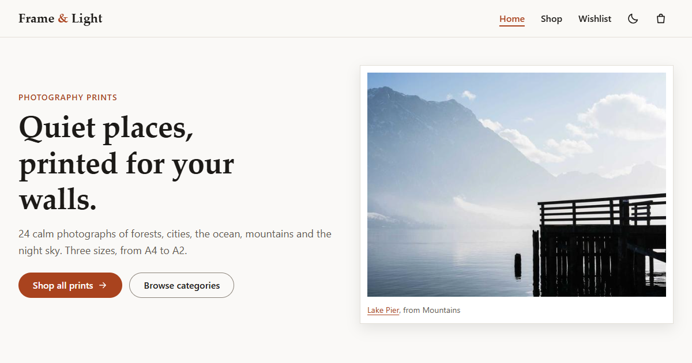

# Frame & Light

A demo online store for photography prints, built with React and Vite.

> **Demo project, not a real store.** Frame & Light is a fictional brand. Nothing is for sale,
> there is no payment and no orders are shipped.



**Live demo:** [https://frame-and-light-store.vercel.app](https://frame-and-light-store.vercel.app)

## What it is

A front-end only shop with 24 photography prints in 6 categories. You can search and filter the
prints, choose a size, add prints to a cart or a wishlist, and place a demo order with
"cash on delivery". There is no backend: the products are a JavaScript file, the photos are
local files, and the cart and wishlist are saved in your own browser (localStorage).

## Features

- **Home:** hero, featured prints and 6 categories (Nature, City, Ocean, Mountains, Minimal, Night)
- **Shop:** responsive grid, search, category filter, price range and sorting (newest, price, name).
  The filters live in the URL, so a filtered page can be shared as a link.
- **Product page:** large photo, sizes A4 / A3 / A2 with different prices, quantity, add to cart,
  add to wishlist and related prints
- **Cart:** change the quantity, remove prints, subtotal, shipping (free over $100, otherwise $8) and total
- **Checkout:** a validated form (name, email, phone, address, city). The only payment option is
  "Cash on delivery (demo)". There are no card fields.
- **Order confirmation** with a generated order number. The cart is cleared.
- **Wishlist** page, **404** page and empty states (empty cart, empty wishlist, no search results)
- Responsive navbar with a mobile menu, a cart count badge and toast messages
- Light and dark mode (follows your system setting, remembers your choice)
- Accessibility: labels, alt text, visible focus, a skip link, full keyboard use and
  color contrast checked against WCAG AA

## Tech stack

| Part | Choice |
| --- | --- |
| UI | React 19, JavaScript (no TypeScript) |
| Build tool | Vite 8 |
| Routing | React Router 8 (`BrowserRouter`, `useSearchParams`) |
| Styles | Plain CSS with CSS variables (no UI library) |
| State | `useReducer` + Context, saved in localStorage (no state library) |
| Tests | Vitest 5 |
| Code checks | ESLint (from the Vite template) |
| Hosting | Vercel |

## How to run

You need **Node.js 22 (22.22 or newer) or Node.js 24**, and npm.

```bash
npm install
npm run dev
```

Then open http://localhost:5173.

| Command | What it does |
| --- | --- |
| `npm run dev` | Starts the development server |
| `npm test` | Runs all tests once |
| `npm run test:watch` | Runs the tests again after every change |
| `npm run lint` | Checks the code with ESLint |
| `npm run build` | Builds the site into `dist/` |
| `npm run preview` | Serves the `dist/` build on your computer |
| `npm run images` | Downloads missing photos (only needed if `public/images/` is empty) |

## Folder structure

```
frame-and-light-store/
├─ docs/
│  ├─ PLAN.md               the plan written before coding
│  └─ HOW_IT_WORKS.md       every file explained + interview questions
├─ public/
│  ├─ images/               48 local photos (24 prints x 2 sizes)
│  ├─ favicon.svg
│  └─ og-image.png          the picture shown when the link is shared
├─ scripts/
│  └─ download-images.js    one-time photo download + JPEG check
├─ src/
│  ├─ main.jsx              starts the app: router + providers
│  ├─ App.jsx               all routes
│  ├─ components/           small reusable parts (navbar, cards, forms ...)
│  ├─ context/              cart, wishlist and toast state (+ reducer tests)
│  ├─ data/                 products.js and sizes.js
│  ├─ hooks/                useTheme, useDocumentTitle
│  ├─ pages/                one file per screen
│  ├─ styles/               design tokens, base, layout, buttons, forms
│  └─ utils/                pure helper functions (+ their tests)
├─ index.html               page title, description and Open Graph tags
├─ vercel.json              sends every route to index.html
└─ package.json
```

## Tests

The tests check the parts with the most rules. They are plain functions, so the tests are short
and fast:

- `cartReducer.test.js`: add, merge the same print and size, quantity limits (1 to 10), remove, clear, broken saved data
- `price.test.js`: size prices, subtotal, shipping rule (exactly $100 still pays $8), total, money format
- `filters.test.js`: reading filters from the URL, search, category, price range, sorting
- `validation.test.js`, `order.test.js`, `wishlistReducer.test.js`, `catalog.test.js`, `storage.test.js`

Run them with `npm test`.

## What I learned

- How `useReducer` keeps all the rules for changing the cart in one pure function that is easy to test.
- How Context shares state (cart, wishlist, toasts) without passing props through many components.
- Why the cart stores only ids, sizes and quantities, and calculates prices from the product data.
- How to keep filters in the URL with `useSearchParams`, so links can be shared and refresh keeps them.
- That React Router 8 updates the URL as a React "transition" by default, and why I turned that off
  (`useTransitions={false}`) after a browser test showed that quick filter changes could use old values.
- How to wrap `localStorage` in `try/catch`, so private mode or broken data never crashes the app.
- Accessible forms: labels, `aria-invalid`, `aria-describedby` and moving focus to the first wrong field.
- Why a single-page app on Vercel needs a rewrite to `index.html`, so a refresh on `/shop` works.
- Responsive images with `srcset`, `sizes`, `width` and `height`, served from local files.

## Credits

- Photos: [Lorem Picsum](https://picsum.photos) (photos by Unsplash photographers), downloaded once
  into `public/images/`. The site does not load images from the internet.
- Frame & Light is a fictional brand made for this demo.
